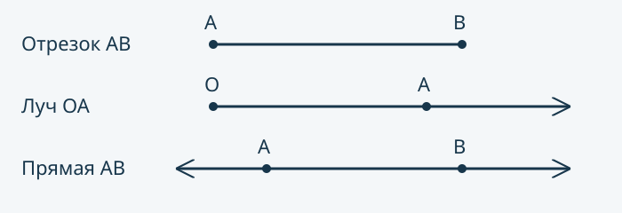

:::hook
Числовой луч вам уже знаком: он начинается в точке 0 и уходит вправо без конца, сколько чисел на нём ни подписывай. Сотрите с него все числа и отметки — останется линия, у которой есть начало, но нет конца. А у нитки, натянутой между двумя гвоздями, два конца. Это разные фигуры, и у каждой своё имя.
:::

Рассмотрите схему ниже: стрелки показывают продолжение без конца, кружки — отмеченные точки. Все задания можно выполнить по схеме и описаниям с клавиатуры. Бумага и линейка — необязательный способ проверить себя. Если далее предложено нарисовать фигуру, вместо рисунка можно записать её начало, концы и направления.



## Точка и прямая

**Точка** обозначает место на листе. Рисуют её маленьким кружком или крестиком и называют большой латинской буквой: $A$, $B$, $O$. Буква здесь — просто имя, как название остановки на схеме. Нарисованный кружок имеет размер, а сама точка — нет: она лишь указывает место.

Проведите по линейке ровную линию и представьте, что она продолжается за края листа в обе стороны без конца. Это **прямая**. Нарисовать её целиком нельзя: на листе помещается лишь её кусок. В этой теме точки с разными именами считаем различными. Прямую называют по двум её различным точкам: прямая $AB$ — та же прямая, что и $BA$.

## Отрезок и луч

Отметьте на прямой две точки $A$ и $B$. Часть прямой между ними вместе с самими точками — **отрезок** $AB$, а точки $A$ и $B$ — **концы отрезка**. Отрезок $AB$ и отрезок $BA$ — один и тот же отрезок: концы у них те же.

Теперь отметьте на прямой точку $O$ и сотрите прямую по одну сторону от неё. Останется **геометрический луч** — для краткости просто луч. Точка $O$ — **начало луча**, а в другую сторону луч продолжается без конца. Луч называют двумя буквами: первая — начало, вторая — любая другая точка луча. Луч $OA$ начинается в $O$ и проходит через $A$; луч $AO$ начинается в $A$ — это уже другой луч.

| Фигура | Концы | Куда продолжается | Как называют |
|---|---|---|---|
| Отрезок | два конца | никуда | $AB$ или $BA$ |
| Луч | одно начало | в одну сторону без конца | $OA$: первая буква — начало |
| Прямая | нет концов | в обе стороны без конца | $AB$ или $BA$ |

Расставьте карточки по корзинам: для каждой модели решите, что она изображает — отрезок, луч или прямую.

```widget
type: sort
title: Отрезок, луч или прямая
bins:
  - id: segment
    label: Отрезок
  - id: ray
    label: Луч
  - id: line
    label: Прямая
items:
  - id: thread
    text: Нитка, натянутая между двумя гвоздями
  - id: beam
    text: Свет фонарика, если считать, что он уходит вдаль без конца
  - id: numray
    text: Числовой луч, с которого стёрли числа и отметки
  - id: piece
    text: Часть числового луча от отметки 2 до отметки 6
  - id: ruler
    text: Линия по линейке через точки A и B, мысленно продолженная в обе стороны
  - id: shelf
    text: Край книжной полки от одного конца до другого
answers:
  thread: segment
  beam: ray
  numray: ray
  piece: segment
  ruler: line
  shelf: segment
mode: bins
feedback: perItem
alt: Шесть карточек с описаниями предметов и три корзины с подписями отрезок, луч и прямая. Карточки пока не разложены.
prompt: Разложите карточки по корзинам. Признак корзины — число концов фигуры, два конца, одно начало или ни одного. Проверьте себя после раскладки.
caption: Фигуру определяет число её концов, а не длина нарисованной линии
minutes: 2
```

:::qa
Можно ли сказать, какой длины луч?
---
Нет. У луча есть начало, но нет второго конца — он продолжается без конца. У отрезка конечная длина: он ограничен двумя концами. Луч и прямая неограниченны, поэтому их длину нельзя выразить конечным числом. Свет фонарика в жизни где-то гаснет, поэтому он лишь модель луча.
:::

:::example{title="Пример 1. Кто есть кто"}
Определим фигуру по описанию: «у меня есть начало, а в другую сторону я продолжаюсь без конца».

1. Начало есть — значит, это не прямая: у прямой нет ни начала, ни конца.
2. Второго конца нет — значит, это не отрезок: у отрезка два конца.
3. Остаётся луч: одно начало и продолжение без конца в одну сторону.

Проверка: нарисуйте фигуру — поставьте точку и проведите от неё линию до края листа. Второй «конец» на рисунке появился из-за края листа; сама фигура там не заканчивается.
:::

## Числовой луч — тоже луч

В теме «Натуральные числа на числовом луче» вы откладывали от точки 0 единичные отрезки и подписывали координаты. Такой числовой луч и есть геометрический луч: начало — точка 0, направление — вправо. Поэтому по координатам видно, лежит ли точка на отрезке или луче. Отрезок с концами 3 и 8 содержит отметки 3, 4, 5, 6, 7, 8 и все точки между ними. Луч с началом в точке 5, идущий вправо, содержит саму точку 5 и всё, что правее неё: правее стоит точка с большей координатой.

Направление луча задаёт вторая буква. Если точка $O$ стоит у отметки 9, а точка $A$ — у отметки 4, то луч $OA$ начинается в 9 и идёт влево: через 8, 7 и дальше до 0. Левее нуля отметок числового луча нет, но прямая там продолжается — и луч вместе с ней.

:::example{title="Пример 2. Какие точки на отрезке, какие на луче"}
На числовом луче отмечены точки 2, 6, 9, 13 и 17. Какие из них лежат на отрезке с концами 6 и 13, а какие — на луче с началом в точке 9, идущем вправо?

1. Отрезку принадлежат оба конца и всё между ними: точки 6 и 13 — концы, точка 9 — между ними.
2. Точка 2 левее конца 6, а 17 правее конца 13 — на отрезке их нет.
3. Лучу принадлежат начало 9 и всё правее: точки 9, 13 и 17. Точки 2 и 6 левее начала.

Ответ: на отрезке лежат 6, 9 и 13; на луче — 9, 13 и 17. Проверка: числа 13 и 17 больше 9, значит, на числовом луче они правее начала луча.
:::

:::note{kind=warn title="Отметки и шаги между ними — не одно и то же" error=E-geom-basic-shapes-gaps-not-marks}
На отрезке с концами 3 и 8 пять единичных отрезков, но шесть отметок: 3, 4, 5, 6, 7, 8. Кто считает шаги между отметками, получает на одну отметку меньше. Концы принадлежат отрезку, поэтому отметки перечисляют вместе с концами.
:::

:::qa
Отрезок на числовом луче содержит ровно три отметки, и один его конец — в точке 7. Где может быть второй конец, если он тоже стоит на отметке с целым номером? Введите оба номера и перечислите отметки каждого случая.
---
В точке 5 или в точке 9: отметки 5, 6, 7 или 7, 8, 9 — по три отметки вместе с концами.
:::

:::deep
**Два луча с началом в одной точке.** Запись луча различает начало и направление; разберём это на одном рисунке.

:::example{title="Пример 3. Два луча с началом в одной точке"}
На прямой слева направо отмечены точки $A$, $O$ и $B$. Какие лучи с началом $O$ можно назвать и совпадают ли лучи $OA$ и $AO$?

1. От точки $O$ прямая идёт в две стороны, поэтому лучей с началом $O$ два: влево через $A$ — луч $OA$, вправо через $B$ — луч $OB$.
2. Луч $AO$ начинается в точке $A$ и идёт вправо, через $O$ и дальше через $B$.
3. У лучей $OA$ и $AO$ разные начала и разные направления, поэтому это разные лучи; общая у них часть прямой между $A$ и $O$ — отрезок $AO$.

Проверка: точка $B$ лежит на луче $AO$, но не лежит на луче $OA$ — значит, лучи действительно разные.
:::

**Самый короткий отрезок.** Постройте на числовом луче самый короткий отрезок, на котором лежат все три отмеченные точки: передвиньте левую и правую границы.

```widget
type: numberline
title: Самый короткий отрезок
range: [0, 15]
step: 1
marks:
  - x: 4
  - x: 7
  - x: 11
mode: interval
answer: [4, 11]
alt: Числовой луч от 0 до 15 с шагом 1. На нём отмечены три точки с координатами 4, 7 и 11, отрезок пока не построен.
prompt: Передвиньте границы так, чтобы отрезок был как можно короче, но содержал все три отмеченные точки.
caption: Концы самого короткого такого отрезка — крайние из отмеченных точек
minutes: 2
```

:::qa
Почему концы самого короткого отрезка — именно точки 4 и 11?
---
Отрезок должен содержать самую левую из отмеченных точек, 4, и самую правую, 11, а значит, и всё между ними. Если сдвинуть любой конец внутрь, одна из этих точек окажется снаружи.
:::

**Сколько точек на отрезке?** На числовом луче видны только отметки с координатами, но точки есть и между ними: между двумя точками отрезка всегда можно поставить ещё одну, и так без конца. Поэтому точек на отрезке бесконечно много, хотя отметок с числами — конечное число.

**Почему у точки нет размера?** Точка задаёт место, а не кусочек листа. Если бы у точки была ширина, место, где встретились две линии, было бы целым пятном, и сказать, лежит ли там третья линия, было бы нельзя. Кружок на рисунке — только метка, которую видно глазом.
:::

:::summary
Точка обозначает место и не имеет размера. Прямая продолжается без конца в обе стороны, отрезок — её часть между двумя точками вместе с концами, луч — часть прямой с началом, которая продолжается в одну сторону. Отрезок $AB$ и отрезок $BA$ совпадают, а у луча первая буква — начало, поэтому лучи $OA$ и $AO$ разные. Числовой луч — геометрический луч с началом в точке 0: на отрезке с концами 3 и 8 лежат шесть отметок вместе с концами.
:::

:::keycard
- Отрезок — два конца, луч — одно начало, прямая — без концов
- Луч $OA$: начало $O$, проходит через $A$
- Отрезок $AB$ совпадает с $BA$, луч $OA$ не совпадает с $AO$
- Отметки отрезка считают вместе с концами: от 3 до 8 — шесть
:::
