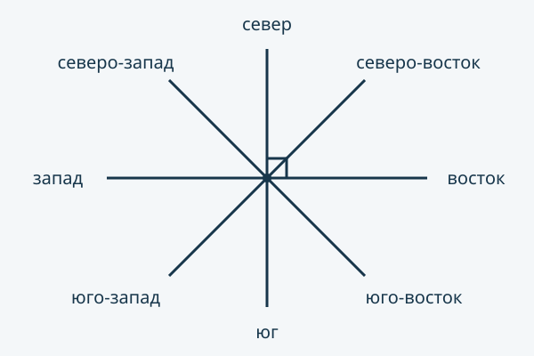

:::hook
Вы вешаете полку и хотите, чтобы она отходила от стены ровно под прямым углом. Угольника под рукой нет. Подойдёт любой лист бумаги: его уголок — готовая модель прямого угла. Как с её помощью отличить острый угол от тупого?
:::

## Модель прямого угла

Уголок обычного прямоугольного листа, обложки книги или ровного дверного проёма служит моделью **прямого угла**. Не любой обрезок бумаги имеет такой угол. Экранная модель — направления вверх и вправо на схеме ниже; сгибание бумаги необязательно. Если у бумаги нет ровного уголка, сложите её пополам, а потом ещё раз так, чтобы линия первого сгиба легла сама на себя. Уголок у сгиба — прямой угол. На чертежах прямой угол помечают маленьким значком-уголком у вершины.

Остальные углы сравнивают с этой моделью.

:::steps{title="Как определить вид угла по модели"}
1. Совместите вершину модели с вершиной угла.
2. Положите одну сторону модели вдоль одной стороны угла; область модели и выбранное раскрытие угла направьте по одну сторону от этого луча.
3. Сначала проверьте, не противоположны ли стороны угла: тогда он **развёрнутый**, модель укладывается в нём два раза.
4. В остальных случаях вторая сторона внутри модели — угол **острый**, совпала со второй стороной модели — **прямой**, снаружи — **тупой**. Совпадающие лучи здесь не рассматриваем.
:::

Острый угол меньше прямого. Тупой больше прямого, но меньше развёрнутого. У развёрнутого угла стороны — два луча с общим началом, идущие в противоположные стороны. Прямая с отмеченной на ней точкой — это одновременно и прямая, и развёрнутый угол с вершиной в этой точке.

## Циферблат как модель

Циферблат часов — модель, которая всегда под рукой. Пусть минутная стрелка указывает на 12. В 3 часа часовая стрелка указывает на 3, и стрелки стоят как стороны уголка листа — угол прямой. Это не совпадение: стрелки на 12 и на 6 смотрят в противоположные стороны, а отметка 3 делит этот развёрнутый угол на два одинаковых — как второй сгиб листа. Если часовая стрелка ближе к 12, чем отметка 3, угол помещается внутри прямого — он острый. Если дальше, но ещё не дошла до 6, угол тупой. В 6 часов стрелки смотрят в противоположные стороны — угол развёрнутый.

После 6 картина повторяется в обратном порядке: в 7 и 8 часов угол тупой, в 9 — прямой, в 10 и 11 — острый. Смотрите на меньший из двух углов между стрелками.

| Вид угла | Что показывает модель | Стрелки часов |
|---|---|---|
| Острый | вторая сторона внутри модели | 1, 2, 10, 11 часов |
| Прямой | вторая сторона совпала со стороной модели | 3 и 9 часов |
| Тупой | вторая сторона снаружи, но не продолжает первую | 4, 5, 7, 8 часов |
| Развёрнутый | стороны составляют одну прямую | 6 часов |

## Стороны света как модель



На схеме север направлен вверх, восток вправо, юг вниз, запад влево. Соседние из этих четырёх направлений образуют прямой угол, противоположные — развёрнутый. Промежуточные направления делят соответствующий прямой угол на две равные части. Например, северо-восток находится посередине между севером и востоком. Для проверки без рисунка запишите направления по кругу в порядке из подписи и сравните число промежутков: два промежутка составляют прямой угол, четыре — развёрнутый.

«На глаз» острый угол выглядит у́же уголка листа, а тупой — шире. Около прямого угла глаз часто ошибается, поэтому в сомнительном случае проверяйте моделью.

:::example{title="Пример 1. Стрелки в 4 часа и в 10 часов"}
Минутная стрелка указывает на 12. Какой угол образуют стрелки в 4 часа и в 10 часов?

1. Модель прямого угла — стрелки на 12 и на 3.
2. В 4 часа часовая стрелка прошла дальше отметки 3, но не дошла до 6: угол шире прямого, а стороны не составляют прямую — он тупой.
3. В 10 часов берём меньший угол — от 12 назад к 10. Часовая стрелка не дошла до 9, где угол был бы прямым, значит, угол помещается внутри прямого — он острый.

Проверка: в 4 часа угол между стрелками целиком содержит угол «12 — 3», то есть модель помещается внутри него, — значит, он действительно больше прямого.
:::

Расставьте карточки по корзинам: в каждой карточке указано время, минутная стрелка указывает на 12.

```widget
type: sort
title: Вид угла между стрелками
bins:
  - id: acute
    label: Острый
  - id: right
    label: Прямой
  - id: obtuse
    label: Тупой
  - id: straight
    label: Развёрнутый
items:
  - id: h2
    text: Ровно 2 часа
  - id: h3
    text: Ровно 3 часа
  - id: h5
    text: Ровно 5 часов
  - id: h6
    text: Ровно 6 часов
  - id: h8
    text: Ровно 8 часов
  - id: h9
    text: Ровно 9 часов
  - id: h11
    text: Ровно 11 часов
answers:
  h2: acute
  h3: right
  h5: obtuse
  h6: straight
  h8: obtuse
  h9: right
  h11: acute
mode: bins
feedback: perItem
alt: Семь карточек с целым числом часов от 2 до 11 и четыре корзины с видами углов. Карточки пока не разложены.
prompt: Разложите карточки по корзинам. Признак корзины — сравнение угла между стрелками с моделью прямого угла, стрелками на 12 и на 3. Проверьте себя после раскладки.
caption: Вид угла задаёт положение часовой стрелки относительно отметок 3, 6 и 9
minutes: 2
```

:::qa
Может ли тупой угол оказаться меньше прямого?
---
Нет. Тупой угол по определению больше прямого: модель прямого угла помещается внутри него. Угол меньше прямого — острый.
:::

:::example{title="Пример 2. Столбик на дорожке"}
Столбик стоит на прямой дорожке и образует с ней прямые углы. Какие углы с вершиной в основании столбика вы видите?

1. В основании сходятся три луча: столбик и две половины дорожки.
2. Столбик с каждой половиной дорожки образует прямой угол — таких углов два.
3. Две половины дорожки образуют развёрнутый угол: его стороны составляют прямую.

Ответ: два прямых угла и один развёрнутый. Проверка: два прямых угла, приложенные друг к другу, как раз заполняют развёрнутый — модель укладывается в нём два раза.
:::

:::note{kind=warn title="Прямой угол — не «угол по прямой»" error=E-geom-basic-shapes-right-as-straight}
Слово «прямой» может сбить: развёрнутый угол, у которого стороны лежат на одной прямой, иногда ошибочно называют прямым. У столбика на дорожке два прямых угла и один развёрнутый; кто считает развёрнутый прямым, насчитает три прямых угла. У прямого угла стороны стоят как края уголка листа, а не продолжают друг друга.
:::

:::qa
Задайте тупой угол двумя направлениями циферблата: один луч направлен на 12, второй выберите сами. Назовите отметку и объясните, как проверить угол моделью. Бумажная модель необязательна.
---
Например, второй луч можно направить на 5: он находится дальше отметки 3, но ближе отметки 6. Совместите вершины и первые стороны; раскрытия модели и угла должны быть с одной стороны. Вторая сторона угла окажется за моделью, но не продолжит первую сторону.
:::

:::deep
**Несколько углов при одной вершине.** Когда из одной точки выходят три луча и больше, углов несколько, и они бывают разных видов.

:::example{title="Пример 3. Острый или тупой — оба правы"}
У буквы Y из одной точки выходят три луча: на 11 часов, на 1 час и на 6 часов. Тимур говорит, что угол в букве острый, Андрей — что тупой. Кто прав?

1. Три луча с общим началом дают три пары лучей — три угла.
2. Между верхними лучами, на 11 и на 1, угол меньше угла «12 — 3»: он острый.
3. Между лучом на 1 и лучом на 6 угол больше прямого и меньше развёрнутого — тупой; так же и между лучами на 6 и на 11.

Ответ: правы оба, они говорят о разных углах буквы — один острый и два тупых. Проверка: приложите модель прямого угла к лучу на 1 — вторая её сторона укажет на 4, а луч на 6 лежит дальше: угол действительно тупой.
:::

**Уголок листа, разделённый разрезом.** Разрез по прямой делит прямой угол на два угла поменьше.

:::qa
Лист бумаги разрезали по прямой от одного уголка до противоположного. Какие углы образует линия разреза с краями листа в этих двух уголках?
---
Острые. В каждом из двух уголков, через которые прошёл разрез, прямой угол листа разделился на два угла, и каждый из них меньше прямого — помещается внутри модели.
:::

**Почему сгиб даёт прямой угол.** После первого сгиба у листа появляется ровный край — кусок прямой. Второй сгиб накладывает одну половину этого края на другую, поэтому два угла у второго сгиба совпадают при наложении и, значит, одинаковы. Вместе они составляют развёрнутый угол. Развёрнутый угол, разделённый на два одинаковых угла, даёт два прямых.

**Как сделать модель надёжнее.** Чем аккуратнее совмещена линия первого сгиба сама с собой, тем точнее прямой угол. Проверка готовой модели: приложите её к уголку книги — стороны должны совпасть по всей длине.
:::

:::summary
Модель прямого угла — уголок прямоугольного листа или лист, второй сгиб которого совмещает первый сгиб с самим собой. Острый угол меньше прямого, тупой больше прямого, но меньше развёрнутого, а у развёрнутого угла стороны составляют одну прямую. Чтобы определить вид угла, совмещают с ним модель: вершину с вершиной, сторону со стороной. Около прямого угла глаз часто ошибается, поэтому в сомнительном случае угол проверяют моделью.
:::

:::keycard
- Острый — меньше прямого, тупой — больше прямого, но меньше развёрнутого
- Прямой — как уголок прямоугольного листа, стрелки ровно в 3 часа
- Развёрнутый — стороны составляют прямую, стрелки в 6 часов
- Два прямых угла с общей вершиной и стороной, расположенные по разные стороны от общей стороны, составляют развёрнутый
:::
